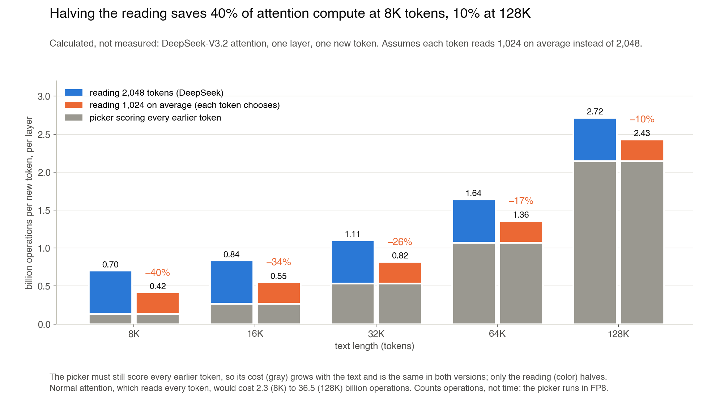
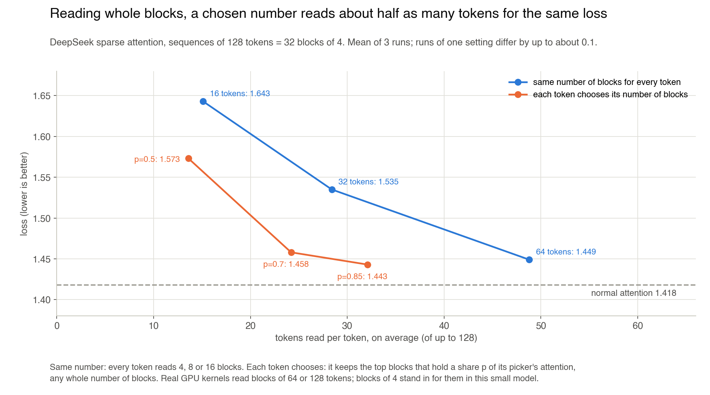
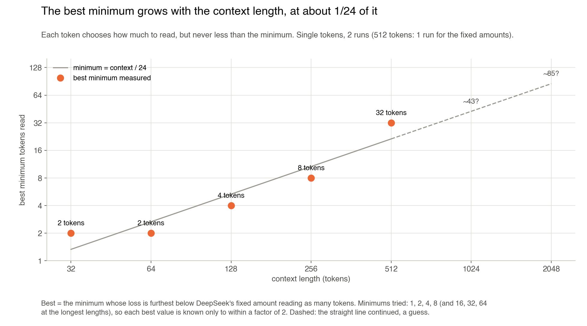
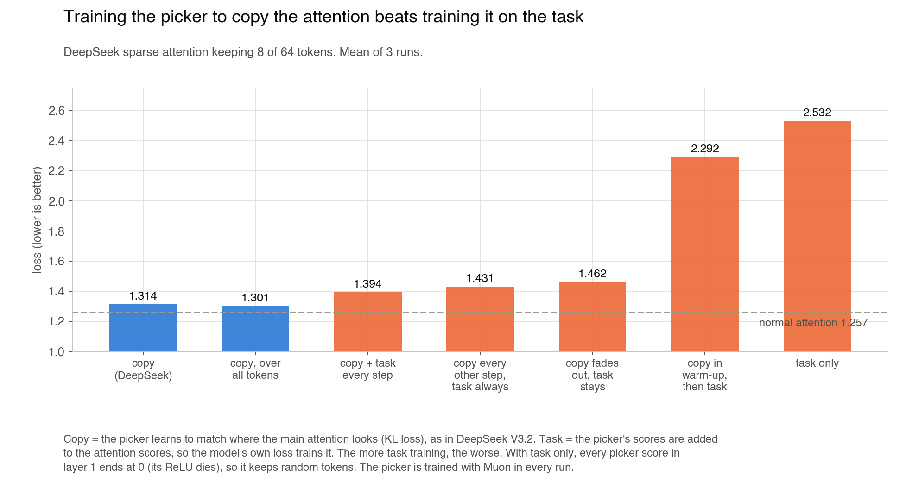

# In DeepSeek sparse attention, let each token decide how many tokens to read

## Long texts are expensive because every token reads every earlier token

When a language model writes the next token, it looks back at the earlier tokens of the text to decide what comes next. This is **attention**. The token doing the looking is called the **query**.

Normal attention reads **every** earlier token. In a 128,000-token text, each new token reads 128,000 earlier tokens, in every layer. The cost grows with the length of the text, and for long texts attention becomes most of the work.

---

## DeepSeek sparse attention reads only 2,048 tokens, the same number for every token

**DeepSeek sparse attention** ([DeepSeek-V3.2](https://arxiv.org/abs/2512.02556)) reads only some of the earlier tokens, in two steps:

1. A small network called the **picker** (DeepSeek calls it the lightning indexer) gives every earlier token a score: how useful it probably is to the query. Scoring a token costs about **17 times less** than reading it.
2. Attention reads only the **top-k**: the 2,048 highest-scored tokens.

Every query reads **the same 2,048** tokens, whatever it needs. But queries need different amounts:

- Continuing a common phrase needs **the last word or two**.
- Answering a question about something said far back needs **a lot of text**.

> **The question:** if each query decides how many tokens to read, can it read fewer tokens for the same quality?

---

## The change: each token reads only as many tokens as its picker scores point to

The picker learns by **copying where attention looks**. So its scores show, for each query, whether attention points at one place or is spread over many places.

I use that to set how much each query reads:

1. Take the highest-scored tokens, one by one.
2. Stop once they hold a set share of the picker's total score, for example **70%**.

| The picker's scores for a query | What the query reads |
|---|---|
| One token holds most of the score | just that token and a few more |
| The score is spread over many tokens | many tokens |

This is called **top-p**, like top-p sampling of words.

A GPU loads earlier tokens in **blocks** of neighbouring tokens, 64 or 128 at a time, so in the main version each query picks **whole blocks**, not single tokens. In this small model a block is **4 tokens**.

---

## What it saves: about half the reading, so 10–40% of attention compute in DeepSeek-V3.2

In a small model with 128-token texts, queries that choose read **24 tokens on average**, where DeepSeek's fixed amount reads 49, with almost the same loss ([Results](#results)).

If the same halving held in DeepSeek-V3.2, each query would read about **1,024 tokens instead of 2,048**. I calculated what that saves from DeepSeek-V3.2's published sizes (128 attention heads, 64 picker heads):

| Text length | DeepSeek (2,048 tokens) | Each token chooses (1,024 on average) | Saved |
|---|---|---|---|
| 8K | 0.70 | **0.42** | **40%** |
| 32K | 1.11 | **0.82** | **26%** |
| 128K | 2.72 | **2.43** | **10%** |

Billion operations of attention per new token, per layer. Normal attention, which reads everything: 2.3 at 8K, 36.5 at 128K.

> **The saving is largest for texts of a few thousand tokens.** In longer texts the picker, which must still score every earlier token, becomes most of the cost, and this change does not make the picker cheaper.

> [!WARNING]
> This is a calculation, not a measurement:
> - the halving was measured only in a small model with short texts;
> - it counts operations, not time (the picker runs in FP8, so its share of the time is smaller and the time saving larger);
> - longer texts may need a larger minimum reading ([below](#grow-the-minimum-with-the-context-length-the-best-minimum-is-about-124-of-it)), which would shrink the saving.

---

## Results

**Loss** measures how wrong the model's guesses of the next token are. **Lower is better.**

### Let each token choose how much to read: it reads half as many tokens for the same quality

Texts of 128 tokens, cut into 32 blocks of 4 tokens:

| Version | Tokens each token reads, on average | Loss |
|---|---|---|
| Normal attention (reads everything) | 64.6 | 1.418 |
| Same number for every token, as in DeepSeek | 48.8 (16 blocks) | 1.449 |
| **Each token chooses** | **24.2 (6 blocks)** | **1.458** |

> **Less than half the reading, and the loss is only 0.009 higher.** That gap is smaller than the difference between two runs of the same setting.

### When reading in GPU blocks, let each token choose, because a fixed amount loses a lot

Reading whole blocks is fast on a GPU, but it **wastes reading**: if a token needs one word, it must also read the 3 words next to it.

Texts of 64 tokens:

| Version | Tokens read | Loss |
|---|---|---|
| 8 single tokens, same for every token | 7.7 | 1.314 |
| 8 tokens as 2 blocks, same for every token | 7.7 | **1.509** (much worse) |
| **Blocks, each token chooses** | **7.6** | **1.371** |

> **With blocks, a fixed number loses a lot. Letting each token choose wins most of it back.**

### There is a minimum number of tokens each token must read, or the model breaks

- With 64-token texts, if a token may read **just 1 token**, the model breaks (loss **1.566** instead of 1.339 with a minimum of 4).
- Why: the picker is sometimes sure about the wrong token, and then the token reads nothing useful.
- **A minimum of a few tokens fixes this.** How many depends on the context length (next section).

The sizes **do not need to be powers of 2** (4, 8, 16, 32 and so on). Any whole number of blocks works about as well.

### Grow the minimum with the context length: the best minimum is about 1/24 of it

I trained the same model on texts of **32 to 512 tokens** (16 times longer from shortest to longest), and tried minimums of 1, 2, 4, 8, 16, 32 and 64 tokens.

For each minimum I asked: **how much lower is the loss than DeepSeek's fixed amount reading the same number of tokens?** The best minimum is the one with the biggest gap.

| Context length | Best minimum | Share of the context | Loss below DeepSeek's fixed amount |
|---|---|---|---|
| 32 | 2 | 6% | 0.03 |
| 64 | 2 | 3% | 0.08 |
| 128 | 4 | 3% | 0.09 |
| 256 | 8 | 3% | 0.15 |
| 512 | **32** | 6% | **0.29** |

> **Each time the context doubles, the best minimum about doubles: it stays near 1/24 of the context (3–6%).** A smaller minimum lets tokens skip what they need; a larger one wastes reading.

Two more things grow with the context:

- **The gain from letting each token choose grows**, from 0.03 at 32 tokens to 0.29 at 512.
- **The gain comes from look-up tasks**, where a token must find one word far back (copying, finding a word's partner). With longer texts the picker misses the right word more often, and a larger minimum still catches it.

> [!WARNING]
> Continuing the straight line is a guess: 4,096 tokens → about **170**, 128K tokens → about **5,000** tokens minimum. Do not trust the exact numbers:
> - in this small model the look-up tasks get harder as texts get longer, and real text may not;
> - the model learns long texts badly in its short training, which makes the picker miss more;
> - each best minimum is known only to within a factor of 2, from 2 runs (the 512-token fixed amounts: 1 run).
>
> What should carry over: **the minimum should grow with the context length, not stay fixed.**

### Use any simple rule for choosing: top-p, ratio and entropy work equally well

I tried three ways to choose:

- **top-p:** keep the top blocks until they hold a share of the picker's score;
- **ratio:** keep every block that scores close to the best one;
- **entropy:** count how spread out the scores are.

> **All three gave about the same results.** What matters is that each token chooses, not how.

### Train the picker to copy where attention looks, not on the model's own loss, or its scores all fall to 0

There are two ways to teach the picker which tokens matter:

- **Copy (DeepSeek's way):** the picker learns to give high scores where the real attention looks.
- **Task:** the picker's scores are added to the attention scores, so the model's own next-token loss trains it directly. This sounds more direct.

Texts of 64 tokens, each token reads 8 (same number for every token):

| How the picker is trained | Loss |
|---|---|
| **Copy where attention looks (DeepSeek)** | **1.314** |
| Copy, plus the model's loss, every step | 1.394 |
| Copy during warm-up, then the model's loss only | 2.292 |
| The model's loss only | 2.532 (much worse) |

Why the model's loss fails. The picker's score for each token passes through a **ReLU**: negative scores become 0.

1. The model's loss reaches only the 8 tokens the picker chose, and for most of them it says **"this one did not help, score it lower"**.
2. Scores keep going down until they drop below 0, where the ReLU turns them into exactly 0.
3. A score at 0 gets **no more training signal**, so it can never come back up.
4. In the end **every score in the second layer is 0** (with copy, about 17 tokens per query score above 0). All tokens tie, so the picker chooses at random.

Copying works because it gives every token a **target score** from the attention, so the picker always knows where to point, not only what to push down.

> **Train the picker by copying the attention. Training it on the model's loss pushes all its scores to 0, and it picks tokens at random.**

The cause in steps 1–3 is my reading of the measurements (all scores at 0, losses above), not a proof.

---

## Where it stops working

### Without blocks, let tokens choose only when they read very little

When a token reads single tokens instead of blocks, choosing helps only **under about 10 of 64 tokens**. Above that, the same number for every token does just as well.

### Do not make 4 neighbouring tokens read the same tokens, unless reading is in blocks

GPUs also like to process 4 neighbouring tokens together, so I let **4 neighbours share one choice** of what to read.

- **Without blocks, this breaks the model** (loss 1.713). One token needs a word far back, its 3 neighbours want other words, and the shared choice serves none of them well.
- **With blocks, sharing costs almost nothing.**

### Test it on a large model before relying on it

> [!WARNING]
> - Tiny model, texts of 32 to 512 tokens, blocks of 4 tokens.
> - Each setting ran **3 times**; runs of one setting differ by up to **0.1**.
> - I measured **quality, not speed**.
> - Whether this holds in large models with blocks of 64 or 128 tokens is **a guess**.

---

## Is this new?

| Work | Reads whole blocks | Each token chooses how many | Minimum size |
|---|---|---|---|
| [DeepSeek-V3.2](https://arxiv.org/abs/2512.02556) | no | no | – |
| [NSA](https://arxiv.org/abs/2502.11089) | yes | no | – |
| [Twilight](https://arxiv.org/abs/2502.02770), [RTPurbo](https://arxiv.org/abs/2605.16928) | no | yes | no |
| **This repo** | **yes** | **yes** | **yes** |

I found no work where each token chooses a number of **whole GPU blocks**, or that shows the choice **helps most with blocks**.

---

## Setup

A 2-layer transformer (width 64, mixture of experts, Muon) trained on a MacBook CPU, 13 seconds to 8 minutes per run, on 8 small tasks such as next-word prediction, copying and finding a word's partner.

- [RESULTS.md](RESULTS.md): every experiment and number
- [experiments/](experiments/): the code
- [chart.py](chart.py): the charts
