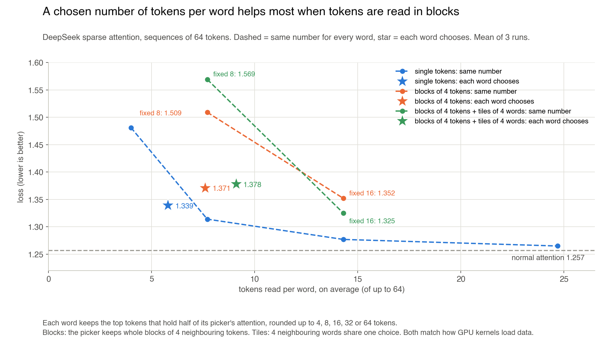
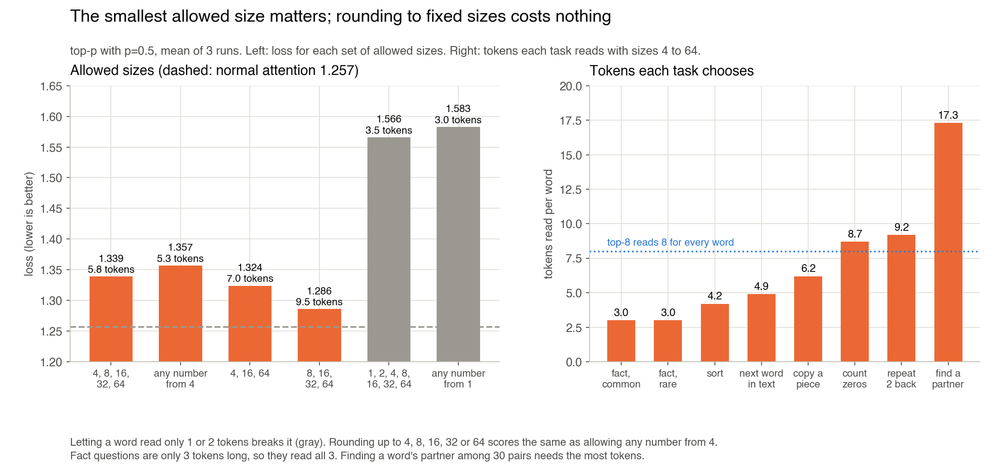
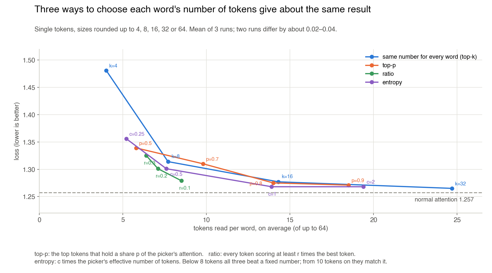

# DeepSeek sparse attention where each token decides how many tokens to read

**DeepSeek sparse attention lets each token read only a fixed number of earlier tokens, chosen by a small learned picker. I let each token choose its own number instead, rounded up to 4, 8, 16, 32 or 64 so GPU kernels still see fixed sizes. When tokens are read in GPU-friendly blocks, this works much better than one fixed number: reading 7.6 tokens on average, it gets close to the loss of a fixed 16.**

## The core idea

When a token looks back at earlier tokens, attention reads every one of them and takes a weighted mix. The token doing the looking is called the **query**. For long texts this reading is the slowest part of a language model.

**DeepSeek sparse attention** ([DeepSeek-V3.2](https://arxiv.org/abs/2512.02556)) reads only some of the earlier tokens. A small, fast network called the **picker** (DeepSeek calls it the lightning indexer) gives every earlier token a score.

Attention then reads only the **top-k**: the k tokens with the highest scores. DeepSeek uses k = 2,048, the same number for every query.

But queries need different amounts. A token that continues a common phrase needs the last word or two. A token that answers a question about something said far back must search a lot of text.

My question: if each query decides how many tokens to read, does the model do better for the same amount of reading, and can it still run fast on a GPU?

## Step 1: how the picker works

For each query, the picker computes a score for every earlier token. It is a tiny attention with 4 heads of size 16: score = sum over heads of weight × ReLU(query · key). It is much cheaper than the real attention.

Attention then keeps the top-k tokens by score and ignores the rest.

In my small model, keeping 16 of 64 tokens matches normal attention on every task. Keeping 4 is clearly worse (loss 1.481 vs 1.257).

## Step 2: how the picker learns

The picker cannot learn from the main loss directly, because "keep or drop" has no gradient. DeepSeek trains it by **copying**: the picker's scores, turned into a probability distribution, are pushed toward where the real attention looks (a KL loss). For the first steps attention stays dense, so the picker can learn before it is used.

I tested 7 ways to train the picker, from pure copying to pure task loss (adding the picker's scores to the attention scores so the model's loss reaches it).

Copying wins. Every amount of task loss makes it worse. With task loss only, all of the picker's ReLU scores in the first layer fell to zero, so it picked tokens at random.

This matters for what follows. Because the picker copies the attention, its scores turned into probabilities are a good estimate of where the attention wants to look. So the picker can tell how spread out each query's attention is.

## Step 3: let each query choose how many tokens to read

The rule: each query keeps its top-scored tokens until they hold half of the picker's probability. A query whose attention sits on one token keeps few. A query whose attention is spread out keeps many. This is **top-p** selection, the same idea as top-p sampling of words.

Then the count is **rounded up** to 4, 8, 16, 32 or 64. GPU kernels are written for fixed sizes, so a few fixed sizes are much easier to make fast than any count from 1 to 64.

Reading 5.8 tokens on average, this scores 1.339. A fixed number of tokens scores 1.481 at 4 and 1.314 at 7.7, so at the same average it is better.

Tasks choose very different amounts. Finding a word's partner among 30 pairs reads 17 tokens. Predicting the next word of text reads 5.

## Step 4: which sizes to allow

The smallest allowed size matters most. If a query may read only 1 or 2 tokens, the model breaks (1.566). The picker is sometimes very sure about the wrong token, and a minimum of 4 is a safety margin.

Rounding up to 4, 8, 16, 32 or 64 costs nothing: it scores the same as allowing any count from 4.

## Step 5: which rule picks the size

I tried two more rules besides top-p:

- **ratio:** keep every token that scores at least r times the best one;
- **entropy:** keep c times the picker's effective number of tokens.

All three land on about the same curve. Below 8 tokens they all beat a fixed number. From 10 tokens on they all match it. So the rule does not matter much; reading each query's own needs does.

## Step 6: make it GPU-friendly

GPU kernels for sparse attention do not load single tokens. They load **blocks** of neighbouring tokens, and they process several neighbouring queries together. I tested three changes that match this:

- **blocks:** the picker scores blocks of 4 neighbouring tokens and keeps whole blocks, as in [NSA](https://arxiv.org/abs/2502.11089);
- **query tiles:** 4 neighbouring queries share one choice and one size, so the kernel loads the same blocks once for all 4;
- **window:** the last 4 tokens are always kept, as in NSA's sliding-window branch.

The results are in the main chart at the top.

- **Blocks make a fixed number much worse:** 2 blocks (8 tokens) score 1.509, against 1.314 for 8 single tokens.
- **A chosen size repairs most of it:** chosen blocks score 1.371 while reading 7.6 tokens, close to fixed 4 blocks (16 tokens, 1.352).
- **Query tiles are nearly free once picking is in blocks:** 1.371 → 1.378. Against a fixed size with the same layout, the chosen size wins at 8 tokens (1.569) and gets close to 16 (1.325).
- **Query tiles without blocks break the model** (1.713). Copying and finding a partner fail: a query that needs one far token shares its choice with 3 neighbours that want other tokens. The always-kept window repairs only part of this. Why blocks repair it, I did not test.

So the layout I would keep is: **blocks of tokens, tiles of queries, and a per-query size rounded up to a few fixed values with a minimum.**

## Where it stops working

- Above about 10 tokens, a chosen size and a fixed size give the same loss. The gain is at small budgets.
- Picking in blocks still costs loss against single tokens (1.371 vs about 1.32 at the same count).
- Two runs that differ only in seed differ by 0.02–0.04, and each setting has 3 runs. Differences under about 0.03 are noise.
- This is a 2-layer model with sequences of 64 tokens. In a real model the budgets would be hundreds or thousands of tokens and blocks would be 64 tokens; whether the same pattern holds there is a guess I have not tested.
- I measured loss, not speed. The claim that fixed sizes, blocks and tiles are faster on a GPU comes from how existing kernels work ([NSA](https://arxiv.org/abs/2502.11089), [FSA](https://arxiv.org/abs/2508.18224)), not from my measurements.

## Is this new?

Partly. These pieces already exist:

- [DeepSeek-V3.2](https://arxiv.org/abs/2512.02556): the picker, trained by copying, with a fixed top-k of single tokens.
- [NSA](https://arxiv.org/abs/2502.11089) and [MiniMax Sparse Attention](https://arxiv.org/abs/2606.13392): picking blocks of tokens, with a fixed count; MiniMax also always keeps a local block.
- [Twilight](https://arxiv.org/abs/2502.02770): top-p budgets on top of an existing sparse method, without training.
- [Full Attention Strikes Back (RTPurbo)](https://arxiv.org/abs/2605.16928): a small picker trained by copying, with top-p per query (p = 0.9), when converting a dense model. It describes no minimum size and no rounding.

I found no published work on:

- rounding each query's budget up to a few fixed sizes, and the finding that the minimum size matters more than the rounding;
- the finding that a per-query budget gains much more when tokens are picked in blocks;
- the finding that sharing one choice across neighbouring queries breaks lookup tasks unless picking is in blocks.

## Setup

A small transformer (2 layers, width 64, mixture of experts, Muon optimizer) trained for about 18 seconds on a MacBook CPU. Like a language model, it learns 8 small tasks mixed into one stream: predicting the next word of text, copying, common and rare facts, repeating a token from 2 back, finding a word's partner among 30 pairs, sorting and counting. Sequences are 64 tokens long, and every setting is run with 3 seeds.

---

- [RESULTS.md](RESULTS.md) has every number per seed, the knobs and the command for each run.
- [toy/](toy/) has the model, tasks and training code; `toy/run.sh SEED` runs one setting.
- [chart.py](chart.py) draws the four charts.
